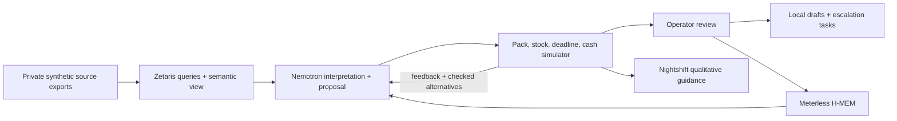

# UnitShift — protect every promise

An operations workspace that connects fragmented stock, supplier quotes, customer commitments and financial evidence, then tests a recovery before an operator creates action drafts.

**Track:** Solving Fragmented Intelligence. **Primary sponsor objective:** meaningful, inspectable NVIDIA Nemotron use. Prize eligibility and results are not guaranteed.

## What the product does

- **Consequence map:** inspect supplier → stock → customer dependencies and trace a shortage to its evidence.
- **Customer promises:** search and filter commitments; inspect quantity allocation and deadline exposure; compare a proposed recovery.
- **Supplier network:** inspect pack prices, unit equivalents, available stock and quoted lead times; compare suppliers side by side.
- **Recovery lab:** adjust budget, supplier availability and verified receipts. Alternatively, describe a disruption in natural language and review the extracted controls.
- **Nemotron planning:** generate a typed purchase proposal from records, run it through a constraint simulator, and provide verified feedback when it is invalid or misses a better checked outcome.
- **Action center:** create persistent purchase-order drafts, customer-update drafts and residual-risk escalation tasks. Repeated drafting is idempotent.
- **Financial controls:** retain the original semantic invoice-review workflow, including pack/item conversion, duplicate-join checks and missing-evidence clarification.
- **Evidence and memory:** inspect actual query/model receipts, the semantic contract and operational memory; export decision JSON.
- **Operations copilot:** Nemotron selects a bounded analytical tool; code renders source-backed facts for risk, deadlines, pack units, suppliers, orders and recovery options. Unknown references are rejected. Inspect the associated model receipt.

There is no external order placement, payment execution, customer messaging, live supplier marketplace or multi-tenant account service. All commercial records are disclosed synthetic data. This is a tested hackathon prototype, not a validated production operations system.

## A complete demonstration

The scenario begins with six customer orders across three SKUs. Opening stock and verified, unposted receiving records support three promises. The other promises are short of stock. Unverified expected inbound is never counted as available.

1. Inspect the shortage in the consequence map.
2. Compare quoted pack units, lead times and prices.
3. Run recovery planning at a $225 purchase budget. A verified plan supports all six promises for $212.
4. Mark Harbor Supply unavailable. At the same budget, the best checked result supports five promises for $225; the simulator finds that $15 more budget permits full recovery.
5. Inspect Nemotron's proposal, the simulator feedback, the actual repair call and the alternatives. A model's assertion does not establish feasibility or optimality.
6. Draft an action packet. Source facts are re-read and the context hash must match. Drafts remain local and unexecuted.
7. Review the resulting tasks and the stored H-MEM preference/constraint lesson.

The dollar figures are results on this disclosed scenario, not customer savings or measured real-world ROI. Supplier history and all quotes are synthetic scenario records.

## Sponsor responsibilities

| Technology | Working role | Inspectable evidence |
|---|---|---|
| Zetaris | Seven registered CSV/JSON source exports in private S3; cross-source query; deadline-based semantic view | Query text, result hashes, source tables and readback counts |
| NVIDIA Nemotron 3 Super via Nebius | Scenario interpretation, typed invoice mappings, independent recovery proposals and feedback-driven repairs | Actual effective model ID, requested thinking controls, token use, proposal and verification receipts |
| NVIDIA Nemotron through Nightshift | Qualitative operator guidance and the existing provider-backed financial explanation | Nightshift route, receipt ID and effective NVIDIA model |
| Meterless H-MEM | Persistent approved supplier preferences and a scoped operational constraint lesson | Real upstream reference-engine add/retrieval calls and ledger entries |

The planner requests a fast structured proposal first. If the proposal violates a constraint or misses a checked target, it requests a bounded reasoning repair with the simulated outcomes and verified alternatives. The code retains a repaired proposal only when it is valid and at least as good under the declared objective. It never silently substitutes a simulator plan while attributing it to Nemotron. An operator can explicitly choose a separately labelled simulator alternative.

Nightshift guidance is qualitative: generated notes containing numbers, currency symbols or an inconsistent risk label are rejected. Displayed costs, quantities, shortfalls and budget gaps come from deterministic calculations. Model narratives are not numerical authorities.

## Data and architecture

The records represent separate operational datasets but are all hosted in the same AWS account and workspace bucket. The prototype does not have live connectors to seven commercial applications.

| Active source | Records | Format |
|---|---:|---|
| Purchase orders | 18 | CSV |
| Invoice lines | 19 | JSON array |
| Receiving records | 20 | JSON array |
| Customer orders | 6 | CSV |
| Opening inventory / verified receipts | 3 | JSON array |
| Supplier offers | 8 | JSON array |
| Operating policy | 1 | JSON array |

`unitshift_control.customer_promises` is a real Zetaris schemastore view joining demand and stock, preserving one row per customer order and allocating available stock in deadline order. The workspace checks that its baseline allocations agree with the simulator before presenting the snapshot. The SQL lives in `data/operational-semantic-view.sql`.



The bounded simulator enumerates pack combinations and prunes only plans with identical per-order coverage and higher cost. Its best checked outcome is for this small source snapshot and objective, not a general large-scale supply-chain optimality claim. Priorities weight revenue exposure, then the objective prefers fewer at-risk orders and lower incremental spend. No supplier reliability score is used as a fabricated probability.

## Run locally

Requirements: Python 3.11+, Node.js and npm. The Python service uses the standard library. H-MEM is an upstream TypeScript reference engine pinned to commit `1742dec56a66e58eef9dda2d2b865823758ca8cd`.

```sh
npm ci
npm run setup:memory
cp .env.example .env.local  # new checkout only; never overwrite configured credentials
npm start
```

Open http://127.0.0.1:8787. The original technical invoice workbench remains at `/review`.

Set these values privately in `.env.local`:

- `ZETARIS_BASE_URL`: the origin of the working AI Data Gateway, which can differ from the cluster hostname.
- `ZETARIS_API_KEY` and numeric `ZETARIS_ORG_ID`.
- `NEBIUS_BASE_URL`, `NEBIUS_API_KEY` and an account-available `NEMOTRON_MODEL`.
- `NIGHTSHIFT_BASE_URL`, runtime access token as `NIGHTSHIFT_API_KEY`, and a discovered routing mode such as `meterless/auto`.
- `DATA_BACKEND=zetaris` for actual source reads; `local` is explicitly labelled fixture mode.

Nightshift must have a working upstream provider or local model. An NVIDIA provider needs an NVIDIA-issued key; a Nebius key authenticates to Nebius, not NVIDIA Build. Keys remain server-side and are never sent to the browser. Keep `.env.local`, `.state`, `node_modules` and `vendor` out of Git.

## Provision and renew sources

With AWS CLI authenticated to the intended account and Zetaris admin settings configured:

```sh
python3 scripts/seed_zetaris.py               # prepare exports and reviewable SQL only
npm run seed:zetaris                         # upload the project prefix and register/update sources
python3 scripts/register_ops_view.py --apply --create-container  # first installation
npm run setup:semantic-view                  # subsequent semantic-view updates
```

The setup currently references the user's hackathon CloudFormation stack in `us-west-1`; configure the stack name for another account. It reuses the workspace bucket, creates no IAM user or public ACL, and mints a temporary read-only federation session limited to `unitshift/v1/`. The connector stores that temporary credential in the user's Zetaris configuration. Its private local cache is `.state/zetaris-s3-session.json` with mode `0600`.

The expiration is recorded in `data/zetaris-manifest.json`. Within an hour before expiry, or after expiry, rerun source setup to obtain a new session and update source credentials. Keep the cluster, source session and Nightshift available if live judging is needed. A recorded demonstration must be identified as a recording.

Source failures, unexpected row grain and empty required datasets do not fall back to local fixture data. Scenario controls are virtual assumptions and never rewrite raw source exports. Opening stock excludes the unposted receiving quantity so that they can be added without double-counting.

## Verification and limitations

```sh
npm test
node --check static/workspace.js
npm run evaluate  # earlier invoice component comparison; actual API calls
```

Thirty-three automated checks cover source handling, quantity conservation, pack pricing, cash/deadline constraints, source-change rejection, ambiguous/dollars-versus-cents interpretation, idempotent drafts, residual-risk escalation and source-locked copilot answers. A clean credential-free checkout was also installed and smoke-tested; the pinned H-MEM reference engine was exercised separately. Real API runs verified normal and supplier-outage recoveries. See `data/evidence/recovery-verified-runs.json` and the actual run receipts. Earlier development failures are diagnostic evidence, not successful submission metrics.

The earlier invoice mapping comparison tied at 13/13 between two-pass and one-pass mapping using the same model and checks, with no demonstrated accuracy advantage for the extra pass. That small held-out set is hold-heavy (12 held, one supported). It is not a benchmark for the expanded recovery planner or evidence of broad production accuracy.

Approval revalidates the latest source snapshot. It does not provide atomic execution against external commercial systems; only local drafts are created. Source templates, schemas and the solver are deliberately bounded to the disclosed scenario. Production use would require real integrations, balanced independent evaluation, authentication, per-tenant access controls, transaction-safe external actions and customer validation.

The receipt log is a local hash chain, not an independently signed attestation. Only concise business proposals and metadata are displayed; private model reasoning is not rendered or stored by this application. Generated code is used in this build. No prior product code is being represented as newly authored sponsor technology.

## Third-party provenance

H-MEM is the Apache-2.0 upstream implementation from [Meterless/Meterless](https://github.com/Meterless/Meterless/tree/1742dec56a66e58eef9dda2d2b865823758ca8cd/engines/hmem/reference). UnitShift's workflow, fixtures, simulator, adapters and UI are new project code. Model weights are not bundled. See `THIRD_PARTY_NOTICES.md`.
