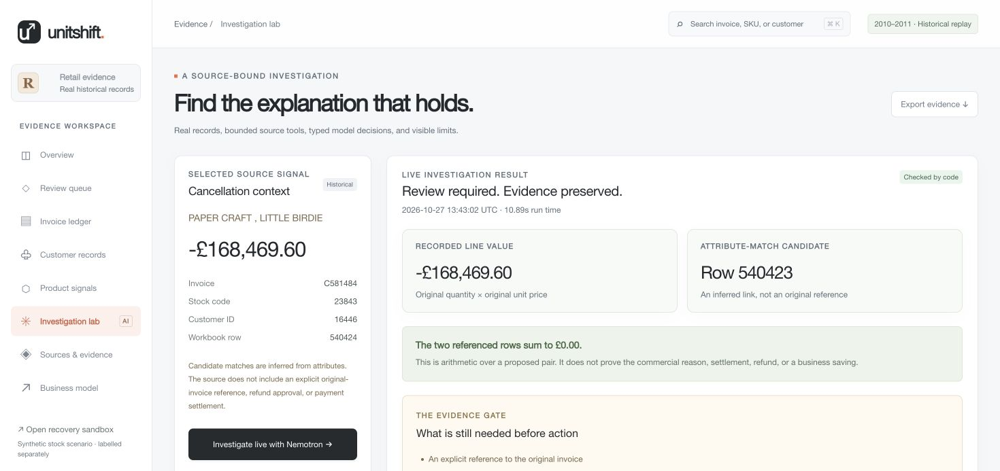
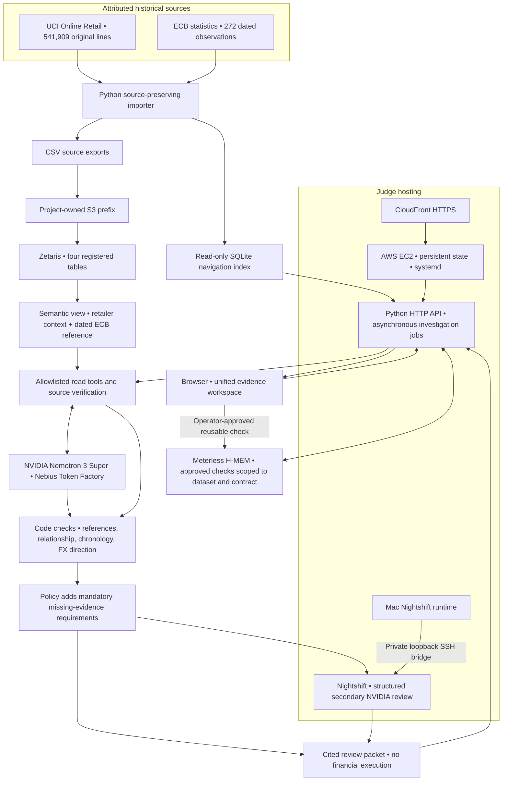

<p align="center">
  
</p>

<p align="center">
  <a href="https://github.com/TusharTechs/unitshift/actions/workflows/ci.yml"></a>
  <a href="LICENSE"></a>
  <a href="https://ds59bjv2cezd6.cloudfront.net/"></a>
</p>

**A finance operations workspace that investigates invoice exceptions across original records and produces a cited review packet before anyone changes the books.**

Built for **Open Agent Hackathon 2026**, Track 1: **Solving Fragmented Intelligence**, with NVIDIA Nemotron as the core investigation model.

## Links for judges

| What it is for | Link |
|---|---|
| Use the deployed product | [Live UnitShift workspace](https://ds59bjv2cezd6.cloudfront.net/) |
| Watch the narrated demo, 3 minutes 7 seconds | [Watch on YouTube](https://youtu.be/Hg4j1Xeox9w) |
| View the pitch materials | [Presentation, deck and captions](https://ds59bjv2cezd6.cloudfront.net/submission/) |
| Read the eight-slide pitch | [PDF deck](https://ds59bjv2cezd6.cloudfront.net/submission/unitshift-deck.pdf) |
| Edit or download the presentation | [PowerPoint deck](https://ds59bjv2cezd6.cloudfront.net/submission/unitshift-deck.pptx) |
| Demo accessibility | [English captions](https://ds59bjv2cezd6.cloudfront.net/submission/unitshift-captions.srt) |
| Inspect the exact filmed investigation | [Recorded result](data/evidence/public-deployed-investigation.json) |
| Inspect actual source and model calls | [Eleven linked receipts](data/evidence/public-deployed-receipts.json) |
| Reproduce source registration and join | [Semantic SQL](data/public/semantic-view.sql) and [registration script](scripts/register_public_data.py) |
| Check data attribution, source hashes and transformations | [Data manifest](data/public/manifest.json) |
| Review test and deployment evidence | [Verification record](data/evidence/deployment-verification.json) and [cross-platform CI](https://github.com/TusharTechs/unitshift/actions/workflows/ci.yml) |
| See the current hosting boundaries | [Judge deployment notes](docs/judge-deployment.md) |
| Review media generation and licenses | [Media provenance](https://ds59bjv2cezd6.cloudfront.net/submission/media-provenance.json) |
| Check project and upstream licensing | [MIT license](LICENSE) and [third-party notices](THIRD_PARTY_NOTICES.md) |

## The problem

An invoice exception rarely contains its own explanation. A reviewer may have to reconstruct the customer context, inspect other transaction lines, compare product identifiers and check reporting-currency references. A convincing model explanation is not enough when the original invoice relationship or payment authorisation is missing.

UnitShift keeps that investigation in one workspace. It separates **what the source records**, **what the model infers**, **what code verifies** and **what evidence the reviewer still needs**.

### A real example

In the published UCI dataset, customer `16446` has two records for stock code `23843` on 9 December 2011:

| Source workbook row | Invoice | Quantity | Unit price, GBP | Calculated line value, GBP | Recorded time |
|---|---|---:|---:|---:|---|
| 540423 | 581483 | 80,995 | 2.08 | 168,469.60 | 09:15 |
| 540424 | C581484 | −80,995 | 2.08 | −168,469.60 | 09:27 |

The lines add to zero. Their matching attributes support a **candidate relationship**. They do not establish the commercial reason, original-invoice reference, payment settlement or refund approval. UnitShift identifies the candidate and requests those missing documents instead of treating arithmetic as permission to act.



## What works

| Workspace | Working capability |
|---|---|
| Overview | Source coverage, historical context and direct investigation entry |
| Review queue | Real cancellation, duplicate-looking, missing-identity and zero-price signals |
| Invoice ledger | All 541,909 original lines, exact invoice/customer/SKU search, original workbook row numbers |
| Customer records | Published anonymised identifiers and transaction context |
| Product signals | Source descriptions and description variants without invented inventory facts |
| Investigation lab | Live source reads, bounded model tools, typed decisions, verification feedback and a visible evidence gate |
| Sources & evidence | Publisher credits, reuse terms, source hashes, registered tables and semantic SQL |
| Business model | An editable pilot-value calculator with explicit assumptions |

A reviewer can inspect actual agent steps and query/model receipts, export JSON or a readable review packet, and save an approved evidence check in scoped memory. Progress indicators follow actual receipts. A failed live request is shown as a failure; a saved result is labelled as a recorded run.

The earlier stock-recovery experiment remains separately labelled at [`/sandbox`](https://ds59bjv2cezd6.cloudfront.net/sandbox). Its commercial records are synthetic. It is read-only on the public deployment and documented in [sandbox notes](docs/recovery-sandbox.md).

## Architecture



### Technical implementation

- **Source grain stays intact.** The importer preserves original workbook row numbers, missing identifiers and duplicate-looking records. It derives invoice/product summaries without presenting them as separate publishers.
- **Zetaris performs the actual join.** `unitshift_control.retail_evidence` joins the transaction grain, invoice summary, product catalogue and dated ECB observation. The recorded full join count is 541,909, so the view does not multiply the source grain.
- **Nemotron uses a bounded tool contract.** It selects from permitted read tools and returns a typed, source-cited proposal. The application checks cited IDs, relationship fields, chronology, arithmetic and FX direction. Invalid proposals can receive verification feedback for repair.
- **Policy requirements remain independent.** Mandatory missing evidence is imposed even if the model omits it. The raw proposal and `policy_added_missing_evidence` remain distinguishable in the result and receipts.
- **Memory requires operator approval.** H-MEM stores reusable checks with a dataset/contract scope. A stale scope cannot silently become the current check.
- **The audit trail is inspectable.** Receipts contain query/model identities, token use, input/output hashes and linked record hashes. This detects changes within the supplied chain; it is not external notarisation.
- **Live reads fail closed.** An unavailable or changed source does not trigger a fixture answer. Jobs persist in SQLite; interrupted jobs are marked explicitly. Public calls are queued and rate-limited.

## Sponsor technology

| Technology | Actual role | Proof to inspect |
|---|---|---|
| **NVIDIA Nemotron 3 Super** on **Nebius Token Factory** | Source-tool selection and cited investigation decisions | Effective model `nvidia/nemotron-3-super-120b-a12b`, actual call usage and verified proposals |
| **Zetaris** | Source verification and the semantic join across retailer context and independent currency reference | Registered source counts, [SQL](data/public/semantic-view.sql), full-grain readback and query receipts |
| **Meterless Nightshift** | A separate structured request-for-evidence review through a working NVIDIA provider | Filmed effective model `nvidia/nemotron-3.5-bolt-e4b`, route evidence and accepted review |
| **Meterless H-MEM** | Approved evidence-check storage and scope-bound recall | Pinned upstream reference engine, ledger IDs, `mem-1` recall in the filmed run and portability integration checks |

The filmed public run completed in **10.89 seconds** and includes all four integrations. That is one observed run, not a latency guarantee or broad accuracy result. Model names are recorded effective identities; availability depends on the provider account.

## Real data and permitted reuse

| Publisher | Data used | Attribution and reuse |
|---|---|---|
| UCI Machine Learning Repository | All 541,909 Online Retail transaction lines, 2010–2011 | Daqing Chen (2015), [DOI 10.24432/C5BW33](https://doi.org/10.24432/C5BW33), [CC BY 4.0](https://creativecommons.org/licenses/by/4.0/) |
| European Central Bank | 272 daily GBP-per-EUR reference observations | [ECB data API](https://data-api.ecb.europa.eu/service/data/EXR/D.GBP.EUR.SP00.A?startPeriod=2010-11-25&endPeriod=2011-12-09&format=csvdata), [statistics reuse policy](https://www.ecb.europa.eu/stats/ecb_statistics/governance_and_quality_framework/html/usage_policy.en.html) |

Raw ECB observations are unchanged. Reporting equivalents are UnitShift calculations using GBP **divided by** GBP per EUR, with the same or preceding source calendar date. They are retrospective reference conversions, not settlement or point-in-time trading rates. The source does not specify a timezone, so source calendar timestamps are preserved.

The review queue is a disclosed selection of 40 value-ranked source signals, not a balanced evaluation sample. Identities remain anonymised as published. The source manifest records hashes, transformations and selection rules. Neither publisher endorses UnitShift.

## Run locally on Windows, macOS or Linux

### Requirements

- **Python 3.11+**, installed and available through `python3`, `python` or the Windows `py` launcher.
- **Node.js 18+** and npm. CI uses Node.js 22 and Python 3.12.
- **Git** and an internet connection for the initial dependency and public-data downloads.
- Enough free disk space for the original archive, CSV exports and SQLite index. No local GPU or model download is needed.

Python application code uses the standard library. Node runs the pinned H-MEM TypeScript reference engine. AWS CLI is only needed if you choose to register your own S3 source deployment.

### Quick start: same commands on all three operating systems

Run these in Terminal, a Linux shell, or Windows PowerShell:

```sh
git clone https://github.com/TusharTechs/unitshift.git
cd unitshift
npm ci
npm run setup:memory
npm run setup:env
npm run setup:public
npm start
```

Open **http://127.0.0.1:8787**.

`setup:env` creates `.env.local` only when it does not already exist. `setup:public` downloads the two primary public sources, checks the UCI archive hash and builds the complete local browsing index. The initial import can take a little time. Downloaded data, generated indexes, credentials and memory state stay in ignored `.state/` or `.env.local` paths.

**Local browsing needs no paid API account.** A new checkout can inspect the ledger and recorded evidence. A fresh live investigation requires the provider configuration below. The app does not substitute a recorded result for an unconfigured live run.

If Python is installed outside your PATH, set its executable explicitly:

```powershell
# Windows PowerShell: replace the example path with your actual Python executable.
$env:UNITSHIFT_PYTHON = "C:\path\to\python.exe"
npm start
```

```sh
# macOS or Linux: use your actual Python executable path.
UNITSHIFT_PYTHON=/path/to/python3 npm start
```

If you already downloaded the source files, import them without downloading again:

```sh
npm run import:public -- --retail-zip "/path/to/online-retail.zip" --ecb-csv "/path/to/ecb-gbp-eur.csv"
```

### Enable live investigations

Edit your local `.env.local`, using your own credentials:

| Variable | What to set |
|---|---|
| `ZETARIS_BASE_URL` | Origin of your working Zetaris AI Data Gateway |
| `ZETARIS_API_KEY` | Gateway API bearer token |
| `ZETARIS_ORG_ID` | Numeric organisation ID, not the cluster hostname |
| `NEBIUS_BASE_URL` | Your Token Factory OpenAI-compatible API base, such as `https://api.tokenfactory.nebius.com/v1` |
| `NEBIUS_API_KEY` | Your server-side Nebius key |
| `NEMOTRON_MODEL` | An available NVIDIA Nemotron model from your account catalogue |
| `NIGHTSHIFT_BASE_URL` | The OpenAI-compatible runtime endpoint shown in Nightshift AI Hotspot |
| `NIGHTSHIFT_API_KEY` | The runtime connection key shown by Nightshift |
| `NIGHTSHIFT_MODEL` | An available runtime model or route, such as `meterless/deep` |
| `DATA_BACKEND` | `zetaris` for live source-backed investigations |

API keys stay server-side and are never needed in the browser. The route label `deep` does not itself guarantee a larger model; inspect the effective model in the receipt.

Register the generated CSVs in **your own** S3 bucket and Zetaris organisation. The registration script supports an uploader AWS CLI profile and a separate, temporary, read-only source session:

```sh
npm run register:public -- --bucket YOUR_BUCKET --region YOUR_BUCKET_REGION --profile YOUR_UPLOAD_PROFILE --credentials-file ".state/source-session.json" --create-container
```

The source-session JSON must contain temporary `AccessKeyId`, `SecretAccessKey`, `SessionToken` and `Expiration` values for a role allowed to read only your source prefix. Never commit it. The uploader profile needs permission to put the four generated files under `unitshift/v1/public/` in your bucket. Omit `--create-container` if `unitshift_control` already exists. Source credentials expire and must be renewed; the judge host's renewal script is deliberately tied to its dedicated deployment role.

Alternatively, omitting `--credentials-file` uses temporary credentials exported by AWS CLI v2 from the selected profile. Long-lived IAM user credentials are rejected. Use a least-privilege source role; the script never writes credential-bearing SQL into receipts.

The script creates/updates the four source tables, registers the semantic view and verifies the full 541,909-row count. It does not reuse the original author's bucket by default.

### Verify your checkout

```sh
npm test
npm run check:platform
node --check static/replay.js
node --check static/workspace.js
```

`npm test` runs **48 regression checks**. The separate platform integration check exercises the actual Node/H-MEM bridge, approved-check recall, stale-scope rejection and read-only SQLite paths containing spaces. With imported data, it also verifies the complete source count and exact invoice navigation. The [CI matrix](https://github.com/TusharTechs/unitshift/actions/workflows/ci.yml) runs on Windows, macOS and Linux, including the complete public-data setup.

## Project structure

```text
unitshift/
├── app/
│   ├── server.py                 HTTP API, static routes and asynchronous jobs
│   ├── replay.py                 Real-data browsing, investigations and evidence gates
│   ├── providers.py              Zetaris, Nebius and Nightshift adapters
│   ├── memory.py                 Cross-platform Node/H-MEM bridge
│   ├── receipts.py               Hash-linked query and model receipts
│   ├── config.py                 Server-side configuration
│   └── operations*.py            Separately labelled recovery sandbox
├── static/                       Evidence workspace, sandbox and engineering UI
├── assets/                       Original UnitShift SVG logo and wordmark
├── data/
│   ├── public/                   Attribution manifest, source snapshot and semantic SQL
│   └── evidence/                 Recorded runs, actual receipts and verification evidence
├── scripts/
│   ├── python.mjs                Python launcher for Windows, macOS and Linux
│   ├── download_public_data.py   Primary-source download and import setup
│   ├── import_public_retail.py   Source-preserving XLSX/CSV ingestion
│   ├── register_public_data.py   Own-account S3/Zetaris source registration
│   ├── memory.ts                 Pinned H-MEM reference-engine calls
│   ├── check_portability.py      Real memory and read-only source integration checks
│   └── refresh_source_access.py  Dedicated judge-host source renewal
├── deploy/                       systemd app and source-renewal units
├── docs/                         Deployment notes, screenshots and sandbox documentation
├── tests/                        Reconciliation, recovery and real-data regression tests
├── .github/workflows/ci.yml       Three-OS verification matrix
├── .env.example                  Configuration names without secrets
├── THIRD_PARTY_NOTICES.md         Upstream and dataset attribution
└── LICENSE                       MIT for original UnitShift code
```

`vendor/hmem/`, `node_modules/`, `.env.local` and `.state/` are generated or private and are excluded from Git. H-MEM is fetched from upstream commit `1742dec56a66e58eef9dda2d2b865823758ca8cd`.

## Evaluation, business model and current boundaries

The recorded real-data examples cover cancellation context, repeated cancellation rows and missing customer identity. The regression suite checks invalid references, source changes, join fan-out, chronology, FX direction, unsupported approval and public call limits. These demonstrate implemented behavior, not independently measured production accuracy.

The proposed first customers are finance operations teams at wholesalers and multichannel retailers. The **£499/workspace/month** offer and review-time calculator are pilot hypotheses. A customer pilot would measure review time, incorrect links, rework and willingness to pay. No paying customers, recovered funds or measured savings are claimed.

The public app runs on **AWS EC2 with encrypted persistent storage behind CloudFront HTTPS**. The primary app, source reads, H-MEM and Nemotron inference run in the cloud. **Nightshift currently runs on the author's Mac through a private loopback SSH bridge**; if that runtime is unavailable, the secondary review is explicitly unavailable while the primary app remains accessible.

The initial judge compute stop is configured for **10 November 2026, 00:00 UTC**. Hosting cost estimates, source renewal and retirement details are in the [deployment notes](docs/judge-deployment.md). Production work includes authorised business connectors, tenant authentication, independent evaluation, private/TLS origin transport and a supported unattended Nightshift host. The prototype creates no external orders, messages, refunds or payments.

## License and provenance

Original UnitShift code and logo are available under the **[MIT license](LICENSE)**, copyright 2026 TusharTechs. That license does not replace the licenses for upstream engines, vendor services, datasets or model weights. H-MEM retains Apache-2.0, UCI data retains CC BY 4.0, and ECB data retains its published reuse terms. See [third-party notices](THIRD_PARTY_NOTICES.md) and [media provenance](https://ds59bjv2cezd6.cloudfront.net/submission/media-provenance.json).

## AI disclosure

| Area | Tools and contribution |
|---|---|
| Research and product development | **OpenAI Codex** assisted research, problem selection, architecture, implementation, debugging, test creation, deployment setup and documentation. Source facts were checked against primary data, actual API responses and visible product behavior. |
| Core product inference | **NVIDIA Nemotron 3 Super through Nebius Token Factory** performs bounded tool selection and cited investigation decisions. **Nightshift** supplies a separate NVIDIA-backed structured review. Application code validates proposals and adds mandatory policy requirements separately. |
| Pitch deck | **Codex with Artifact Session** assisted narrative, editable slide authoring, evidence tables and visual QA. The product screenshots are actual captures. |
| Demo narration | **Microsoft Edge neural text-to-speech**, generic `en-US-AndrewMultilingualNeural` voice through the open-source `edge-tts` client, supplied synthetic narration. No real person's voice was cloned or impersonated. |
| Captions | Word timings come from the speech engine's word-boundary events. Caption text is the authored narration. |
| Video and audio production | **Claude Code** assisted the script, storyboard and editing. Motion graphics were built with **Remotion**. Product footage is actual Playwright capture of the deployed app, including a live investigation shown at 1× speed; agent-trace values are taken from the committed run receipts. The score and sound effects were synthesized procedurally in Python for the film, and FFmpeg handled loudness mastering. |
| Visual identity | The original **SVG logo and wordmark were authored with Codex assistance**, using the project's U/arrow motif. They are vector assets, not a third-party logo or fabricated product screenshot. |
| YouTube thumbnail | Composed in **Remotion** from an actual capture of the live investigation result. No generated imagery. |

Cursor was not used. AI-generated explanations are not treated as source truth or authorisation. Historical data, model inferences, policy additions, recorded runs and business hypotheses are labelled separately throughout the project.
